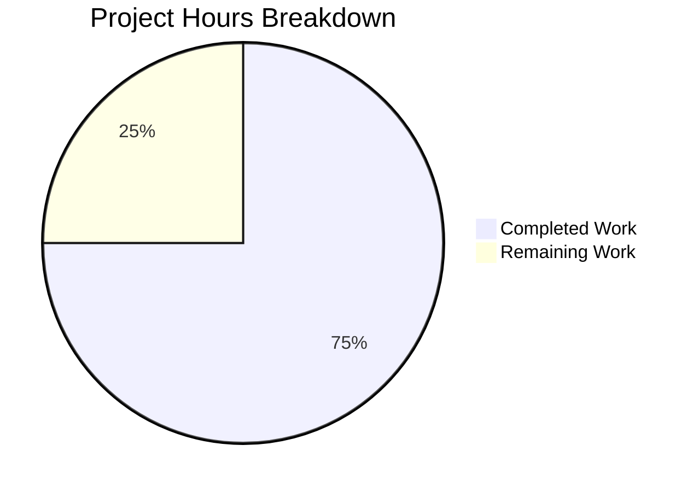

# 1. Executive Summary

## 1.1 Project Overview

This project delivers a single static text artefact: `hello_world.txt` at the repository root, whose entire content is the line `Welcome to Blitzy` repeated exactly 65,000 times, one occurrence per line, every line terminated by a single LF. It is content, not code — 1,170,000 bytes of literal ASCII with no program, runtime, dependency or build step behind it — and its footprint is deliberately empty. Its audience is the requester and any reviewer or program that counts, searches or reads its lines.

## 1.2 Completion Status

**75.0% complete — 7.5 of 10.0 scoped hours delivered.**



| Metric | Hours |
|---|---|
| Total Hours | 10.0 |
| Completed Hours (AI + Manual) | 7.5 |
| Remaining Hours | 2.5 |

**Completion % = Completed Hours / (Completed Hours + Remaining Hours) × 100 = 7.5 / (7.5 + 2.5) × 100 = 75.0%.**

Of the 24 scoped requirements, 23 are complete: 21 with no caveat, and 2 complete in outcome but carrying a caveat. The one partial requirement is the write's failure branch, whose guarantee lives in the command that produced the file rather than in the repository.

## 1.3 Key Accomplishments

- `hello_world.txt` holds the literal line `Welcome to Blitzy` exactly 65,000 times, one per line, every line LF-terminated including the last.
- Byte contract verified exactly: 1,170,000 bytes (18 × 65,000), UTF-8 without a byte-order mark, no CR byte, every byte US-ASCII or LF.
- Content verified exhaustively, not sampled: one distinct 17-character line, no header, separator, numbering or blank line.
- The five acceptance checks and both encoding probes pass against the working-tree file.
- Regeneration is deterministic and byte-identical, and a pre-existing file of that name is replaced outright, never appended to.
- The repository gains exactly that one file; the pre-existing `README.md` is byte-identical to its baseline blob.
- An exhaustive defect matrix — byte-order mark, CRLF, unterminated last line, duplicated terminator, appended copy, short write, same-length substitution, padded lines — is caught.

## 1.4 Critical Unresolved Issues

**3 of the 24 scoped items carry an open caveat or an unexercised branch; the other 21 are complete with no caveat.** Nothing in the delivered artefact is missing or wrong.

| Issue | Impact | Owner | ETA |
|---|---|---|---|
| The removal-and-fail write branch was never fired against the delivered file; it has no committed implementation because no generator may be committed | None on the artefact — it is complete and byte-exact, or it would be absent; a future regeneration has no committed guard | Repository owner | With the next release-checkout verification — 0.5 h |
| No automated protection of the byte contract: no test, fixture or CI job may be committed, and a hosted diff of a file this size renders truncated | A later edit that breaks the byte contract or the line content is caught only by a hand-run check | Repository owner | With the next change to the file — 0.5 h |
| The committed LF bytes depend on the checkout's line-ending configuration, and the repository may carry no attributes file | A clone outside that configuration would render the file as CRLF (1,235,000 bytes) and fail the byte check on an otherwise correct commit | Repository owner / whoever configures clones | Decide and record — 0.5 h |

## 1.5 Access Issues

No access issues identified. No permission, credential, network path or third-party account is required.

## 1.6 Recommended Next Steps

1. **[High]** Run the acceptance gate on the release checkout and record its output, treating the byte total and the anchored identity count as the load-bearing readings. (0.5 h)
2. **[Medium]** Settle the checkout line-ending policy for clones outside the current configuration and record the decision. (0.5 h)
3. **[Medium]** Rehearse the regenerate-and-verify sequence, including the failure behaviour, and record the check set where the team keeps release procedure. (1.0 h)
4. **[Low]** Decide the fate of the provisioned but unused secret with the platform owner. (0.5 h)

# 2. Project Hours Breakdown

## 2.1 Completed Work Detail

| Component | Hours | Description |
|---|---|---|
| Deliverable materialisation and commit | 0.5 | Write the whole 65,000-line artefact in one pass at the repository root and commit it as the branch's single change (`hello_world.txt`, 65,000 insertions, 0 deletions). |
| Format and byte-contract specification | 1.5 | Fix the 17-character unit, the 65,000 repetition count, the LF terminator rule on every line including the last, the UTF-8-without-BOM encoding and the 1,170,000-byte arithmetic, and reconcile the superseded counts to the governing figure. |
| Acceptance verification | 1.5 | Run the five acceptance checks, both encoding probes, the baseline-relative repository-footprint check and the digest against the working-tree file. |
| Defect-class verification | 2.0 | Measure deliberately broken copies — byte-order mark, uniform CRLF, unterminated last line, duplicated trailing terminator, appended copy, short write, same-length substitution, blank and padded lines — against the check set and record the load-bearing reading for each class. |
| Reproducibility and whole-replacement verification | 0.5 | Prove that regeneration is deterministic and byte-identical and that the write truncates a pre-existing target rather than appending to it. |
| Repository footprint and scope-compliance verification | 1.0 | Confirm the repository gains only the deliverable, that no executable payload, credential, manifest, test, workflow, documentation or configuration is present, and that pre-existing content is byte-identical to its baseline. |
| Write-failure mechanism rehearsal | 0.5 | Demonstrate in a scratch reproduction that a write which cannot complete exits non-zero leaving no file behind, and that a truncated artefact is rejected by the count and byte readings. |
| **Total** | **7.5** | |

## 2.2 Remaining Work Detail

| Category | Hours | Priority |
|---|---|---|
| Release-checkout acceptance run — the five checks plus both encoding probes against the working-tree file, in Git Bash, with the output recorded (path-to-production) | 0.5 | High |
| Checkout line-ending policy — decide and record how clones outside the current configuration keep the committed LF bytes, since the repository may carry no attributes file | 0.5 | Medium |
| Regenerate-and-verify rehearsal and a verification-standard record held outside the repository — rehearse the write, the checks and the removal-and-fail behaviour, and record the standard where the team keeps release procedure | 1.0 | Medium |
| Review of the provisioned but unused secret with the platform owner — no file reads, references or needs it | 0.5 | Low |
| **Total** | **2.5** | |

## 2.3 Calculation Transparency

The scoped work universe is 24 requirements: 12 covering content and format, 6 covering reproducibility and repository scope, 1 covering the write's failure semantics, 4 covering verification, and 1 covering security and hygiene. Hours are assigned to those requirements and to the path-to-production activities the delivered file needs before it is release-ready.

| Scope bucket | Requirements | Completed hours | Remaining hours |
|---|---|---|---|
| Content and format | 12 | 4.0 | 0.5 |
| Reproducibility and repository scope | 6 | 1.5 | 0.0 |
| Failure semantics | 1 | 0.5 | 1.0 |
| Verification | 4 | 1.5 | 0.5 |
| Security and hygiene | 1 | 0.0 | 0.0 |
| Path-to-production and environment review (outside the requirement set) | — | 0.0 | 0.5 |
| **Total** | **24** | **7.5** | **2.5** |

**Formula with its numbers:** Completion % = Completed Hours / (Completed Hours + Remaining Hours) × 100 = 7.5 / (7.5 + 2.5) × 100 = **75.0%**.

The single partially complete requirement is the write's failure semantics: its outcome is satisfied — the delivered artefact is complete and byte-exact, never a plausible prefix — and its mechanism was reproduced in a scratch exercise, but the removal-and-fail branch itself is a property of the command that produced the file, cannot be committed (no generator may enter the repository), and never fired against the delivered artefact. Its unfinished half is carried in the 1.0-hour regenerate-and-verify rehearsal above, whose purpose is to rehearse the behaviour and record it where it can be followed. The remaining half-hour against content and format is the checkout line-ending policy, the half-hour against verification is the release-checkout acceptance run, and the half-hour outside the requirement set is the provisioned but unused secret described in Section 5.2.

# 3. Test Results

This project has no test framework, test source, fixture, linter, dependency scanner or CI definition, and none may be added: the deliverable is one static text file, and the request requires that nothing beyond it enter the repository. Its test suite is therefore the POSIX check set, run from the repository root in Git Bash. Every reading below was executed against the delivered working-tree file or against a deliberately broken copy held outside the repository, and the counts are of readings whose output was observed, not of test files.

| Area / Category | Framework | Tests | Passed | Failed | Coverage | What This Proves |
|---|---|---|---|---|---|---|
| Content and line identity | POSIX checks (Git Bash) | 5 | 5 | 0 | Exhaustive over all 65,000 lines | Every line is exactly the 17-character unit `Welcome to Blitzy`, with one distinct line and no second content region. |
| Byte contract and encoding | POSIX checks + a byte-level reader (Python 3.13) | 7 | 7 | 0 | Every one of the 1,170,000 bytes read | The file is exactly 1,170,000 bytes, UTF-8 without a byte-order mark, and its entire byte alphabet is LF, space and the unit's eleven letters. |
| Terminator structure | POSIX byte probes | 3 | 3 | 0 | Final and penultimate bytes plus a full LF census | Every line including the last ends with a single LF: no missing terminator, no duplicated one, no blank final line. |
| Defect-class discrimination | POSIX checks against 4 deliberately broken copies | 15 | 15 | 0 | One defect at a time on copies held outside the repository | A byte-order mark, uniform CRLF, an unterminated final line and a duplicated trailing terminator are each caught, and the reading that catches each is identified. |
| Reproducibility and whole replacement | One-process write into scratch, `cmp` and digest | 4 | 4 | 0 | Byte-for-byte over the whole file | Regeneration is deterministic and byte-identical, and the redirect truncates a pre-existing target rather than appending to it. |
| Repository footprint and history | `git` and `find` | 5 | 5 | 0 | Complete baseline-relative inventory of the tree | The repository gains exactly one path, adds no directory, and leaves pre-existing content byte-identical to its baseline blob. |
| Source hygiene and secret scan | `grep` and `find` over the tree | 3 | 3 | 0 | Whole tree, both tracked files | No unfinished-work marker, no executable file, no shebang and no credential-shaped content exists; the deliverable's byte alphabet could not hold one. |

**Not Covered**

- **The removal-and-fail write branch.** It is a property of the command that produced the file, has no committed implementation because no generator may be committed, and never fired against the delivered artefact; only its mechanism was reproduced outside the repository. Before release, rehearse the full sequence — write, verify, and on a failed reading remove the artefact and fail the run — and record that it behaves as specified.
- **Automated regression protection.** Nothing in the repository guards the byte contract, by requirement, and a hosted diff of a 65,000-line file renders truncated. Any later edit to the file must be followed by a hand-run of the whole check set, with the byte total and the anchored identity count treated as the load-bearing pair.
- **Line-ending behaviour of a checkout that converts line endings.** This checkout does not convert, so the failure mode was not exercised end to end: a clone configured otherwise would render the committed LF bytes as CRLF and measure 1,235,000 bytes. Verify one such clone, or settle the configuration so that it cannot occur.
- **Any application, service or interface runtime.** The project has no HTTP surface, database, queue, container, configuration source, credential or rendered screen, so those categories have no surface to test rather than untested ones.
- **Shells other than Git Bash.** The check set is defined for Git Bash; under other shells the footprint and sort commands resolve to different programs and the anchored pattern can be mangled, so a run there misreports and is not a supported path.

# 4. Runtime Validation & UI Verification

The deliverable is inert literal text, so its "runtime" is the tool set that reads it. Every line below was driven against the delivered working-tree file or against a copy held outside the repository.

- ✅ **Artefact read-back across the tool set** — the line count, distinct-line count, anchored match count, byte total, final byte, byte-order-mark probe, both CR probes, the digest and the per-line length histogram all agree on 65,000 lines of one 17-character line totalling 1,170,000 bytes.
- ✅ **Independent read on a second runtime** — a byte-level reader on a separate language runtime reports 1,170,000 bytes, 65,000 LF, 0 CR, no byte-order mark and one distinct line, matching the tool set exactly.
- ✅ **Regeneration flow** — the single-process write, run into a scratch path, reproduces the delivered file byte-for-byte with the identical digest, in both its inline and its variable form; a second run into the same path leaves the same result.
- ✅ **Whole-replacement behaviour** — a scratch target pre-filled with one line and another pre-filled with 65,001 lines each end at exactly 65,000 lines and 1,170,000 bytes after the write, so the redirect replaces rather than appends.
- ⚠ **Write-failure path** — a write into a non-existent directory and a write onto a directory target each exit non-zero, leaving no file behind and silently creating no directory; the removal-and-fail branch itself was never fired against the delivered artefact and has no committed implementation, so it is exercised only as a mechanism (see Section 3).
- ✅ **Footprint and baseline** — the repository inventory gains exactly the one deliverable; the footprint check prints only the pre-existing file, which is the pre-write baseline provable from the baseline commit; the working tree is clean and the pre-existing file's blob is unchanged.
- ✅ **Integrity during validation** — the artefact's size, mode and digest were unchanged before and after every exercise, and no reading wrote anything inside the repository.
- ✅ **Content inertness** — the file carries no executable payload, is not executable, and nothing in the tree parses, evaluates, serves or renders it.
- ⚠ **Hosted review of the artefact** — a diff of a 65,000-line file renders truncated on a hosted review, so the content cannot be verified by reading a diff; verification must run against the working-tree file.
- ❌ **No application, service or interface runtime** — there is no screen, endpoint, service, database, container, configuration source or credential, so no user journey, API call, integration or UI surface was driven and none applies; no browser or desktop validation is meaningful anywhere in this project.

# 5. Compliance & Quality Review

## 5.1 Compliance Matrix

| Deliverable | Requirement | Status | Verified By |
|---|---|---|---|
| `hello_world.txt` at the repository root | Exists under the exact name, repository-relative, no containing directory | ✅ Pass | File listing, tracked-file set, single-path change set |
| Line content | Every line exactly `Welcome to Blitzy`, 17 characters, unformatted | ✅ Pass | One distinct line; length histogram of 17; 65,000 anchored matches |
| Repetition count | Exactly 65,000 occurrences | ✅ Pass | Line count, record count and single-group count |
| Terminator | LF after every line including the last; one trailing newline; no blank final line | ✅ Pass | Final and penultimate bytes; LF census equal to the line count |
| Byte total | Exactly 1,170,000 bytes, arithmetic closed at 18 × 65,000 | ✅ Pass | Byte count, committed blob size, arithmetic |
| Encoding | UTF-8 without a byte-order mark; every byte US-ASCII or LF | ✅ Pass | First-bytes probe; complete byte alphabet enumerated |
| Line endings | No CR byte anywhere | ✅ Pass | Two independent CR probes; byte alphabet; byte total |
| Committed machinery | No generator, template, build step, manifest, dependency, test artefact or CI file | ✅ Pass | Whole-tree sweeps; 0 executables; 0 shebangs; two tracked non-source files |
| Repository footprint | Gains only the deliverable; pre-existing content neither modified nor deleted | ✅ Pass | Baseline-relative inventory; blob identities at baseline and head |
| Reproducibility | Regeneration deterministic and byte-identical; whole replacement, never append | ✅ Pass | Scratch regeneration compared byte-for-byte; pre-filled targets replaced |
| Write failure behaviour | A write that cannot complete leaves no partial or short file | ⚠ Partial | Failure mechanism reproduced outside the repository; the removal-and-fail branch never fired against the delivered file |
| Security posture | No executable payload, credential, secret or untrusted input; no dependency surface | ✅ Pass | Byte alphabet; credential, key, token and URL scans; no manifest, so no advisory surface |

## 5.2 AAP & Rule Divergences and Gaps

No user-specified rules were provided for this work, so nothing in that set is departed from. Five matters diverge from the plan's own record, none of them requested by the requester, and none of them changing a byte of the delivered artefact.

| What the AAP/Rule Required | What Was Delivered Instead | Why It Diverged | Impact | Remediation |
|---|---|---|---|---|
| The materialisation as the literal command with the unit embedded in double quotes: `awk 'BEGIN{for(i=0;i<65000;i++)print "Welcome to Blitzy"}' > hello_world.txt` | The byte-equivalent spelling passing the unit through a variable: `awk -v s='Welcome to Blitzy' 'BEGIN{for(i=0;i<65000;i++)print s}' > hello_world.txt` | The shell that invokes native programs on this host strips embedded double quotes before the program sees them, so the literal spelling produced an empty file there; the variable form survives both shells | None on the artefact — byte equality is proven, not asserted (`cmp` reports no differences against the delivered file, and both hash to `5bfdc450…006b`) | None. Use either spelling in Git Bash; prefer the variable form where quoting may not survive. Section 9 gives both. |
| Recorded host values: awk = mawk 1.3.4, bash 5.2.21, coreutils 9.4, grep 3.11, findutils 4.9.0, `xxd` absent, locale C.UTF-8, `gzip -9` = 2,901 bytes | The values actually measured here: GNU Awk 5.4.1, bash 5.3.15, coreutils 8.32, grep 3.0, findutils 4.11.0, `xxd` present at `/usr/bin/xxd`, locale `en_US.UTF-8`, `gzip -9` = 2,908 bytes | The recorded values describe a different machine; they say nothing about the file, whose bytes depend on none of them | Anyone following the recorded versions cannot re-confirm them, and the byte-probe substitution is unnecessary here; no behavioural claim is affected — both probe tools read the same byte, and the locale changes no reading | None for the artefact. Use the measured values in Section 9 and Appendix D when re-running the checks. |
| The recorded detection mapping: the anchored pattern catches a CR before the terminator, and the plain CR probe prints 0 on a good file and 2 on a CRLF file | Verification used the discriminating forms — the binary-mode CR probe and the stream-count CR probe (`tr` piped into `wc -c`) — with the byte total as the load-bearing CR detector and the anchored identity check for content | This host's text-mode tools strip a CR that sits immediately before the terminator, so the recorded spellings are blind to exactly the case they exist to catch; the same collation effect makes the distinct-line reading locale-dependent for a first-line byte-order mark | A reviewer running only the first three checks and the final-byte probe would pass a CRLF artefact (1,235,000 bytes) as correct | Use the check set in Section 9 as a whole; record it where the team keeps release procedure (the 1.0-hour item in Section 2.2). |
| Footprint-check baseline: the pre-existing root file is `metering-inventory.md`, 9,462 bytes | The repository contains no such path and never did; the pre-existing root file is `README.md`, 52 bytes, and the footprint check is judged against it | The recorded baseline describes a different checkout; the repository's own history is the authoritative inventory, and the check is baseline-relative for exactly that reason | None — a correct write passes either way, and the pre-existing file is untouched. A reader comparing literally against the recorded name would look for a file that is not in the repository | None. |
| No environment variable or secret was supplied, and none is needed | No file reads, references or needs a secret and the deliverable is inert text — but one user-named secret is present in the environment, and the deliverable's byte alphabet could not carry one | It was provisioned to the environment out of band; no repository path can change or consume it | None on the artefact or its verification; it is a hygiene matter should code ever be added to this repository | Review with the platform owner and withdraw it or confirm it stays — the 0.5-hour item in Section 2.2. |

**Why the materialisation changed spelling.** The literal command embeds the repeating unit in double quotes, and the shell used on this host to launch native programs strips embedded quotes before the program sees them; measured, the literal spelling there produced an empty file. The variable form passes the unit through an argument that both shells deliver intact. Equality with the prescribed command is demonstrated rather than assumed: the regenerated file compares byte-identical to the delivered one and hashes to the same digest, and running the literal spelling inside Git Bash reproduces the same bytes. Because the command is transient and never committed, it is not reviewable repository content; the artefact's bytes are, and they are identical either way.

**Why the recorded toolchain values do not re-confirm.** The values describe the machine on which the plan was written, not the machine on which the standard now runs, and none of them is a property of the file: the content's bytes are fixed by the unit, the count and the terminator, not by which awk or grep build reads them. Every substantive claim the section supports was re-verified here — the one-process write reproduces the delivered bytes exactly, both byte-probe tools read the same final byte, the locale changes no reading, and the command contains no pipe. The practical consequence is documentation only: an engineer following the recorded versions verbatim will not find `mawk` or a host without `xxd`. Section 9 and Appendix D record what this host actually provides.

**Why the recorded detection mapping matters.** The five acceptance checks are sound as a set, but they are not equally discriminating, and the recorded mapping overstates what three of them catch here. Measured on a deliberately CRLF copy, the anchored pattern still matches every line, and the plain CR probe returns zero on both a good file and a CRLF file; the same text-mode behaviour hides a missing final terminator from the anchored pattern, and the distinct-line reading is collation-dependent for a first-line byte-order mark. The delivered artefact passes every reading either way, and its LF-only property is established by the byte total (a CRLF file measures 1,235,000), the binary-mode CR probe and the stream-count CR probe. The risk is for whoever verifies next: run the set as a whole.

**Why the footprint baseline names a different file.** The plan's inventory names a path that is not in this repository and was never in its history — the baseline commit contains `README.md` alone. The check that depends on that inventory is baseline-relative: it asks whether anything beyond the pre-existing content was added, and it names whatever pre-existing file the tree actually holds. Here that file is `README.md`, 52 bytes, whose blob hash is identical at the baseline commit, at the head commit and in the working tree, so nothing was modified or deleted. A reader who greps for the recorded name will find nothing; that is the record's inaccuracy, not a missing file.

**Why the provisioned secret appears here.** The plan records that no secret was supplied and that none is needed, and that remains true of the deliverable: it is inert literal text that parses nothing, executes nothing and reads no configuration, and the secret's name appears in neither tracked file. The secret is nonetheless present in the environment because it was provisioned out of band. Nothing about the artefact's correctness or its verification turns on it, which is why it is recorded as hygiene rather than a defect — but a credential that nothing consumes is worth a decision, and the same environment would deserve a second look before any code is added to this repository.

# 6. Risk Assessment

These are forward-looking: what could still go wrong with this artefact in use.

| Risk | Category | Severity | Probability | Mitigation | Status |
|---|---|---|---|---|---|
| A clone whose git configuration converts line endings renders the committed LF bytes as CRLF, measuring 1,235,000 bytes and failing the byte check on an otherwise correct commit | Technical / Operational | Medium | Medium | Configure the cloning host not to convert line endings — the repository itself may carry no attributes file — and run the acceptance gate on every checkout, treating the byte total as the load-bearing reading | Open — mitigated by configuration and the acceptance run |
| No automated protection of the byte contract: the repository holds no test, fixture or CI job by requirement, and a hosted diff of a file this size renders truncated, so a later edit is caught only by a hand-run check | Technical | Medium | Medium | Run the documented check set on every change to the file; the byte total and the anchored identity count are the load-bearing pair | Open — mitigable by procedure |
| Individual checks have measured blind spots: the anchored pattern passes a CRLF artefact, the byte count passes a same-length character substitution, and the distinct-line reading is collation-dependent for a first-line byte-order mark | Technical | Medium | Low | Always run the complete set — byte total, both CR probes, anchored identity, first-bytes probe — rather than the subset that appears to apply | Open — mitigated by running the full set |
| Regeneration through the wrong writer or shell produces a wrong or empty file: a byte-order mark, CRLF, UTF-16 output, or a command whose embedded quotes are stripped before the program sees them | Technical | Medium | Low | Regenerate with the documented one-process form in a POSIX shell and follow the write with the check set | Open — mitigated by procedure |
| A credential is provisioned to an environment whose project consumes none | Security | Low | Low | Withdraw it or confirm it should stay; no file reads, references or needs it, and the deliverable's byte alphabet could not carry one | Open — pending a decision |
| A manual regeneration that stops part-way leaves a short file that a partial check could accept | Operational | Low | Low | Follow the documented sequence and verify the byte total, which a truncated file cannot pass | Open — mitigated by procedure |

# 7. Visual Project Status

**Project Hours Breakdown — 75.0% complete**


Completed work is dark blue (**#5B39F3**); remaining work is white (**#FFFFFF**).

**Remaining hours by category**

| Category | Hours | Priority |
|---|---|---|
| Release-checkout acceptance run | 0.5 | High |
| Checkout line-ending policy | 0.5 | Medium |
| Regenerate-and-verify rehearsal and verification-standard record | 1.0 | Medium |
| Review of the provisioned but unused secret | 0.5 | Low |
| **Total remaining** | **2.5** | |

**Verification coverage at a glance**

| Scoped requirement group | Requirements | Complete | Partial |
|---|---|---|---|
| Content and format | 12 | 12 | 0 |
| Reproducibility and repository scope | 6 | 6 | 0 |
| Failure semantics | 1 | 0 | 1 |
| Verification | 4 | 4 | 0 |
| Security and hygiene | 1 | 1 | 0 |
| **Total** | **24** | **23** | **1** |

The delivered artefact itself is complete and verified: 65,000 LF-terminated lines of the 17-character unit `Welcome to Blitzy`, 1,170,000 bytes, UTF-8 without a byte-order mark, no CR byte anywhere, and a repository that gained exactly that one file. What remains is release preparation and one environment decision, not unfinished product work.

# 8. Summary & Recommendations

The project asked for one thing: a file named `hello_world.txt` holding the line `Welcome to Blitzy` exactly 65,000 times, with no formatting and no script that generates it. That file is delivered at the repository root and committed. Its content is literal: 65,000 occurrences of a 17-character line, each terminated by a single LF including the last, 1,170,000 bytes in total, UTF-8 without a byte-order mark, with no CR byte anywhere and no header, separator, numbering or blank line. The repository gained exactly that one path — no manifest, dependency, build step, template, test, workflow, documentation or configuration — and its pre-existing file is byte-identical to its baseline blob. Scoped work stands at **75.0% complete**: 7.5 of 10.0 hours delivered, with the remainder being release preparation and one environment decision rather than unfinished product work.

The verification behind that statement is exhaustive rather than sampled. Every one of the 1,170,000 bytes and all 65,000 lines were measured, not estimated: the line count, distinct-line count, anchored match count, byte total, final byte, encoding probes and digest all agree, and an independent byte-level reader on a second runtime returns the same figures. Deliberately broken copies confirm that each defect class is caught — a byte-order mark, uniform CRLF, an unterminated final line, a duplicated trailing terminator, an appended copy, a short write, a same-length character substitution, blank and padded lines — together with the reading that carries the weight for each. Regeneration is deterministic: the single-process write reproduces the delivered bytes exactly, and the redirect replaces a pre-existing target instead of appending to it.

Three things remain open, and none of them is a defect in the artefact. The write's removal-and-fail branch is a property of the command that produced the file, has no committed implementation because no generator may be committed, and never fired against the delivered file. Nothing in the repository guards the byte contract afterwards, since no test, fixture or CI job may be added and a hosted diff of the file renders truncated. And the committed LF bytes depend on the checkout not converting line endings, a configuration decision the repository itself cannot record. The critical path to production is short and procedural: run the acceptance gate on the release checkout (0.5 h), settle the line-ending policy (0.5 h), rehearse the write-check-fail sequence and record the verification standard where the team keeps release procedure (1.0 h), and decide the fate of the provisioned but unused secret (0.5 h).

**Production readiness: ready, with the three caveats above.** The artefact is complete, byte-exact, reproducible and inert; it carries no executable payload, no credential, no untrusted input and no dependency surface, and it introduces no runtime, service or configuration. Its only requirements are release hygiene. The recommended sequence is to run the acceptance gate on the target checkout before sign-off, treat the byte total and the anchored identity count as the two readings that cannot be traded away, and record the check set outside the repository so the contract survives the next change to the file.

| Success metric | Target | Observed |
|---|---|---|
| Line count | 65,000 exactly | 65,000 |
| Line content | The 17-character unit, unformatted | One distinct line, every line 17 characters |
| Byte total | 1,170,000 exactly | 1,170,000 |
| Encoding and terminator | UTF-8, no byte-order mark, LF on every line including the last | No byte-order mark, final byte `0a`, zero CR bytes |
| Repository footprint | One added path, pre-existing content untouched | One added path; pre-existing file's blob unchanged |
| Reproducibility | Regeneration byte-identical | Regeneration compares byte-identical, same digest |
| Scoped hours | — | 7.5 completed of 10.0 (75.0%) |

# 9. Development Guide

## 9.1 System Prerequisites

There is nothing to install, build or start. The deliverable is one static text file with no runtime, package, dependency or service, and the repository must gain nothing else:

- **Git for Windows**, which supplies the Git Bash shell the verification commands are written for.
- The POSIX text utilities that install already provides — `awk`, `wc`, `sort`, `grep`, `tail`, `head`, `od` (and usually `xxd`), `tr`, `find`, `cmp` and `sha256sum`.
- No compiler, package manager, database, container, web server or port. The project binds no port and holds no configuration, so no service startup is part of the workflow.

## 9.2 Environment Setup

Run every command from the repository root, and run all of them in **Git Bash** — not PowerShell, where `sort` and `find` resolve to different programs and an anchored pattern can be mangled, so the checks silently misreport.

Before touching the file, confirm that this checkout does not translate line endings. The output must be `false`:

```bash
git config --get core.autocrlf
```

If it prints `true` or nothing, set it for this clone before writing or checking anything:

```bash
git config core.autocrlf false
```

Leave the repository's file list untouched: add no `.gitattributes`, no configuration file and no script. The two tracked files should be the deliverable and the pre-existing scaffold file:

```bash
git ls-files
```

```
README.md
hello_world.txt
```

## 9.3 Obtaining the Artefact

A plain checkout gives you the file — nothing is generated, built or downloaded. Confirm you have the intended one:

```bash
wc -c hello_world.txt
sha256sum hello_world.txt
```

```
1170000 hello_world.txt
5bfdc450a28086d985956cd3682f14734597b1be5a9def6fdfc850b3d077006b *hello_world.txt
```

## 9.4 Verification Sequence

Run these from the repository root and compare each line with the expected output. Taken together they are the acceptance gate for this artefact; no single one is sufficient.

```bash
wc -l hello_world.txt
sort -u hello_world.txt
grep -c '^Welcome to Blitzy$' hello_world.txt
tail -c 1 hello_world.txt | od -An -tx1
wc -c hello_world.txt
head -c 3 hello_world.txt | od -An -tx1
grep -U -c $'\r' hello_world.txt
tr -cd '\r' < hello_world.txt | wc -c
find . -type f -not -path './.git/*' -not -name hello_world.txt
```

```
65000
Welcome to Blitzy
65000
 0a
1170000
 57 65 6c
0
0
./README.md
```

What each reading establishes, and what it catches:

- `wc -l` = 65000 — the repetition count, and a missing final terminator (which would read 64999).
- `sort -u` = the single line — one distinct line, so no header, separator or blank line.
- `grep -c '^Welcome to Blitzy$'` = 65000 — the exact unit on every line, with nothing added. It is blind to a CR before the terminator and to a missing final newline, which the other readings cover.
- `tail -c 1` = ` 0a` — the last line is terminated. Where `xxd` is available, `tail -c 1 hello_world.txt | xxd` prints `00000000: 0a`, the same byte formatted differently.
- `wc -c` = 1170000 — the load-bearing reading. It is the one that catches CRLF (1,235,000), a byte-order mark (1,170,003) and a duplicated final terminator (1,170,001).
- `head -c 3` = ` 57 65 6c` — the file starts with the unit, so there is no byte-order mark.
- Both CR readings = 0 — no carriage return anywhere. On this host, a plain `grep -c $'\r'` is blind to a CR that sits immediately before a line terminator, so use these forms.
- `find` prints `./README.md` — the pre-existing file, which is expected. Only paths a new write adds may fail this reading.

For a stricter content check, the whole file can be measured rather than spot-checked:

```bash
awk '{print length($0)}' hello_world.txt | sort -u
python -c "d=open('hello_world.txt','rb').read(); print(len(d), d.count(b'\n'), d.count(b'\r'), d[:3]==b'\xef\xbb\xbf')"
```

```
17
1170000 65000 0 False
```

## 9.5 Writing or Regenerating the Artefact

The content is literal and no generator may be committed, so regeneration is a single transient command with a truncating redirect — one process, no pipe, no temporary file, nothing left behind:

```bash
awk -v s='Welcome to Blitzy' 'BEGIN{for(i=0;i<65000;i++)print s}' > hello_world.txt
```

The equivalent inline spelling, if your shell passes embedded quotes through intact:

```bash
awk 'BEGIN{for(i=0;i<65000;i++)print "Welcome to Blitzy"}' > hello_world.txt
```

Where no POSIX shell is available, this .NET call writes the identical bytes:

```powershell
[IO.File]::WriteAllText((Join-Path (Get-Location) 'hello_world.txt'), ("Welcome to Blitzy`n" * 65000), (New-Object Text.UTF8Encoding($false)))
```

After any write, run Section 9.4 in full. The redirect truncates the target before the first byte is written, so an existing file of that name is replaced outright and the result is exactly 65,000 lines whether or not the file was there. If any reading fails, delete `hello_world.txt` and fix the cause rather than delivering a short or mis-encoded file.

## 9.6 Example Usage

```bash
head -n 1 hello_world.txt        # Welcome to Blitzy
tail -n 1 hello_world.txt        # Welcome to Blitzy
tail -c 2 hello_world.txt | od -An -tx1   #  79 0a  — the final unit and its terminator
wc -l < hello_world.txt          # 65000
grep -c '^Welcome to Blitzy$' hello_world.txt   # 65000
```

## 9.7 Troubleshooting

| Symptom | Cause | Fix |
|---|---|---|
| Byte count 1,170,003, first bytes ` ef bb bf` | A byte-order mark was written | Write with a tool that emits UTF-8 without a mark, as in Section 9.5, and re-run the checks |
| Byte count 1,235,000 and both CR readings report every line | The file was materialised as CRLF — a checkout that converts line endings, or a text-mode writer | Set the checkout not to convert (Section 9.2) and rewrite the file |
| Line count 64,999 and final byte `79` | The last terminator is missing | Rewrite with the one-process form, which terminates every record, then re-check |
| Line count 65,000 but the anchored count reads 0 | A CR or another character sits before the terminator, or the letter case differs | Rewrite the file; confirm with the CR readings and the byte total |
| Counts doubled — 130,000 lines, 2,340,000 bytes | The content was appended rather than replaced | Rewrite with the redirect, which truncates the target first |
| The write prints nothing and leaves an empty file | The shell stripped the embedded double quotes from the command | Use the variable form in Section 9.5 |
| The readings misreport — the anchored count shows 0, `find` prints nothing | The commands ran in PowerShell rather than Git Bash | Re-run them in Git Bash |
| `find` names a path that is not `README.md` | A file was added that the request does not allow | Remove it: the repository must hold nothing beyond the deliverable |

# 10. Appendices

## Appendix A — Command Reference

All commands run from the repository root in Git Bash. Expected output is shown for the delivered artefact.

| Purpose | Command | Expected |
|---|---|---|
| Line count | `wc -l hello_world.txt` | `65000` |
| Distinct lines | `sort -u hello_world.txt` | `Welcome to Blitzy` |
| Occurrences of the exact unit | `grep -c '^Welcome to Blitzy$' hello_world.txt` | `65000` |
| Final byte | `tail -c 1 hello_world.txt \| od -An -tx1` | ` 0a` |
| Final byte (alternative tool) | `tail -c 1 hello_world.txt \| xxd` | `00000000: 0a` |
| Final two bytes | `tail -c 2 hello_world.txt \| od -An -tx1` | ` 79 0a` |
| Total bytes | `wc -c hello_world.txt` | `1170000` |
| No byte-order mark | `head -c 3 hello_world.txt \| od -An -tx1` | ` 57 65 6c` |
| No CR — binary mode | `grep -U -c $'\r' hello_world.txt` | `0` |
| No CR — stream count | `tr -cd '\r' < hello_world.txt \| wc -c` | `0` |
| Line length set | `awk '{print length($0)}' hello_world.txt \| sort -u` | `17` |
| Digest | `sha256sum hello_world.txt` | `5bfdc450a28086d985956cd3682f14734597b1be5a9def6fdfc850b3d077006b` |
| Repository inventory | `find . -type f -not -path './.git/*' -not -name hello_world.txt` | `./README.md` |
| Line-ending setting | `git config --get core.autocrlf` | `false` |
| Tracked files | `git ls-files` | `README.md`, `hello_world.txt` |
| Working-tree state | `git status --porcelain` | (no output) |
| Write the artefact | `awk -v s='Welcome to Blitzy' 'BEGIN{for(i=0;i<65000;i++)print s}' > hello_world.txt` | no output; 65,000 lines, 1,170,000 bytes |

## Appendix C — Key File Locations

| Path | Role |
|---|---|
| `hello_world.txt` | The entire deliverable: 65,000 LF-terminated lines of `Welcome to Blitzy`, 1,170,000 bytes, UTF-8 without a byte-order mark. Mode 644, non-executable. |
| `README.md` | Pre-existing scaffold file (52 bytes). Not part of this project's deliverable; present at the baseline commit and unchanged in the working tree, so its appearance in the inventory reading is expected. |
| `.git/` | Version control data. The only two commits are the baseline commit and the single commit that adds the deliverable. |

No source tree, test tree, configuration directory, documentation directory, script directory, container or workflow directory exists. No port is bound and no service is started, so no port reference applies.

## Appendix D — Technology Versions

The deliverable declares no dependency and no manifest, so nothing is pinned. The versions below are what verification runs on in this environment, measured rather than assumed.

| Tool | Version | Used for |
|---|---|---|
| Git for Windows / Git Bash | bash 5.3.15 | The shell every check is written for |
| awk | GNU Awk 5.4.1 | Writing the artefact; measuring line lengths |
| wc, sort, tail, head, od, tr, cmp | GNU coreutils 8.32 | The count, distinctness, byte and terminator readings |
| grep | GNU grep 3.0 | The anchored match count and the binary-mode CR reading |
| find | GNU findutils 4.11.0 | The repository inventory reading |
| xxd | present at `/usr/bin/xxd` | The alternative final-byte probe; the `od` form reads the same byte |
| Python | 3.13 | An independent byte-level read-back |
| gzip | 1.15 | Measuring the packed size (~2.9 KB, about 0.25% of the file) |

## Appendix E — Environment Variable Reference

No environment variable is read, set or required by the deliverable: it is inert literal text that parses nothing, and the repository holds no configuration or environment file.

| Name | Status | Note |
|---|---|---|
| `LANG` / `LC_ALL` | Present in the environment | Affects collation only. Every check reading here is byte-based and unchanged across locales; the distinct-line reading on `sort -u` is the one reading that can differ under a different collation for a file carrying a byte-order mark, so run it with `LC_ALL=C` if that case is in play. |
| Provisioned secret (user-named) | Present in the environment, unused | No file reads, references or needs it. See Section 5.2 and the corresponding line in Section 2.2. |

## Appendix F — Developer Tools Guide

- **Use Git Bash for everything here.** It is the only shell in which the verification sequence behaves as documented; other shells resolve `sort` and `find` to different programs and can mangle the anchored pattern, so their output is not evidence about this file.
- **Never write the artefact through a text-mode redirect.** In PowerShell, `>`, `Out-File` and `Set-Content` emit UTF-16 with a byte-order mark and CRLF. Use the commands in Section 9.5, then verify.
- **Keep the clone's line-ending setting at `false`.** This is the one configuration that stands between the committed LF bytes and a working tree that measures 1,235,000 bytes. The repository cannot record it, because no attributes file may be added.
- **Read the file by reading bytes, not by opening it in an editor.** Editors may rewrite the final newline or normalise line endings; for review, prefer `wc`, `grep`, `tail` and `od`, and remember that a hosted diff of a 65,000-line file renders truncated.
- **Treat the check set as a unit.** Individual readings have blind spots — the byte count cannot see a same-length character substitution, the anchored pattern cannot see a CR before a terminator, and the distinct-line reading can ignore a byte-order mark under a collation that treats it as ignorable.
- **Nothing guards the file automatically.** There is no test runner, linter or CI job in this repository and none may be added, so run Appendix A after every change to the file.

## Appendix G — Glossary

| Term | Meaning |
|---|---|
| LF | Line feed, byte `0x0A`. The terminator this artefact uses on every line, the last included. |
| CR / CRLF | Carriage return, byte `0x0D`. CRLF is the Windows line ending; a file in that form here measures 1,235,000 bytes and is not the deliverable. |
| Byte-order mark (BOM) | Three bytes (`ef bb bf`) some tools prepend to UTF-8 text. It would push the total to 1,170,003 and put stray bytes on line 1, so this file has none. |
| POSIX line | Zero or more characters followed by a terminating newline. A final line without a terminator is not counted by `wc -l`, which is why the last line is terminated. |
| Unit | The repeated content of one line: `Welcome to Blitzy`, 17 characters, 18 bytes with its terminator. |
| Byte total | 18 bytes × 65,000 = 1,170,000 bytes. The arithmetic leaves no byte unaccounted for. |
| Footprint check | Comparing the repository's file inventory before and after a write: only paths the write adds may fail, so a pre-existing file never fails the reading. |
| Baseline-relative | Judged against the inventory recorded before the write rather than against an assumed-empty tree. |
| Digest | The SHA-256 hash of the file's bytes, used to identify the artefact: `5bfdc450a28086d985956cd3682f14734597b1be5a9def6fdfc850b3d077006b`. |
| Deterministic regeneration | Re-running the write produces the same bytes, so the file is its own record of its content. |
